# ⚙️ MechaStudy VNU — Nền Tảng Học Tập & Mô Phỏng Cơ Điện Tử Toàn Diện
> **Trợ lý Kỹ sư Cơ Điện Tử Thông Minh — Trường Đại học Công nghệ, ĐHQGHN (VNU-UET)**

[](https://uet.vnu.edu.vn)
[](https://developer.mozilla.org)
[](https://katex.org)
[](https://www.mathworks.com)
[](https://github.com)
[](LICENSE)

---

## 📌 1. Giới thiệu tổng quan & Sứ mệnh dự án

Ngành **Kỹ thuật Cơ điện tử (Mechatronics Engineering)** tại **Trường Đại học Công nghệ – Đại học Quốc gia Hà Nội (VNU-UET)** là ngành học liên ngành kết hợp giữa **Cơ học kỹ thuật**, **Kỹ thuật điện tử**, **Điều khiển tự động** và **Mô phỏng máy tính (MATLAB/Simulink)**.

Trong quá trình học tập, sinh viên thường gặp các rào cản lớn:
1. **Khó hình dung chuyển động cơ học và dạng sóng tín hiệu:** Các bài toán tĩnh học giàn, cơ cấu 4 khâu bản lề, con trượt thanh truyền, hệ dao động lò xo - giảm chấn, mạch Op-Amp và điều khiển động cơ DC có rất nhiều hình vẽ phức tạp. Nếu không có **mô hình động mô phỏng trực quan**, việc hiểu bản chất vật lý và chuyển động thực tế là cực kỳ khó khăn.
2. **Cần đối chiếu số liệu tính toán lý thuyết với mô phỏng máy tính:** Khi làm bài tập lớn hoặc báo cáo thực hành, sinh viên bắt buộc phải viết mã MATLAB/Octave hoặc Python để mô phỏng đáp ứng hệ thống theo thời gian (Time Response, Step Response, Đồ thị Bode, Quỹ đạo nghiệm số).
3. **Lưu trữ dữ liệu học tập lâu dài:** Sinh viên cần một nền tảng không phụ thuộc vào máy chủ trung gian, tự động đồng bộ tài liệu, đề thi, bài giải lên kho lưu trữ cá nhân (GitHub Repository) và tra cứu ngoại tuyến (Offline-first) bằng IndexedDB.

**MechaStudy VNU** được phát triển nhằm giải quyết triệt để các bài toán trên, mang đến một **Giao diện làm việc kỹ sư chuyên nghiệp (Modern Engineering Dashboard)**, loại bỏ hoàn toàn các yếu tố rác/debug, phông chữ Việt hóa hoàn hảo (`Be Vietnam Pro` & `JetBrains Mono`), kết hợp công nghệ AI đa mô hình và phòng thí nghiệm tương tác 60 FPS.

---

## 🚀 2. Bốn Trụ Cột Tính Năng Cốt Lõi

```mermaid
flowchart TD
    A["⚙️ MechaStudy VNU Studio"] --> B["⚡ Bộ Quét Đề & Giải AI (MechaSolver)"]
    A --> C["🔬 Phòng Thí Nghiệm Động Học Ảo (MechaLabs)"]
    A --> D["💻 MATLAB & Python Studio"]
    A --> E["📚 Thư Viện Chuyên Đề & GitHub Sync"]

    B --> B1["OCR PDF/Ảnh bài tập & đề thi"]
    B --> B2["Giải chi tiết từng bước (LaTeX/KaTeX)"]
    B --> B3["Biểu đồ tự do FBD & Sơ đồ mạch (SVG)"]
    B --> B4["Tự động sinh mã MATLAB & Python"]

    C --> C1["Lab 1: Cơ cấu 4 khâu & Con trượt (Kinematics)"]
    C --> C2["Lab 2: Dao động lò xo - giảm chấn (m-c-k, RK4)"]
    C --> C3["Lab 3: Xe trượt - Con lắc ngược (LQR Auto-balance)"]
    C --> C4["Lab 4: Mạch Op-Amp & Máy hiện sóng ảo (Scope)"]
    C --> C5["Lab 5: Điều khiển PID Động cơ DC (Step Response)"]

    D --> D1["Template Tĩnh học & Nội lực dầm M(x), Q(x)"]
    D --> D2["Template Động lực học Lagrange (ode45)"]
    D --> D3["Template Phân tích tần số Bode & Root Locus"]
    D --> D4["1-Click Copy & Xuất file .m / .py"]

    E --> E1["Khung chương trình chuẩn Cơ điện tử VNU-UET"]
    E --> E2["Đồng bộ GitHub REST API & Tránh xung đột SHA"]
    E --> E3["Bộ nhớ đệm ngoại tuyến IndexedDB"]
```



### ⚡ Trụ Cột 1: Bộ Quét Đề & Giải Bài Tập Cơ Điện Tử (Smart MechaSolver)
- **Tải lên đa định dạng:** Hỗ trợ kéo thả đồng thời nhiều ảnh PNG, JPG hoặc file PDF giáo trình/đề thi với bộ lọc dải trang thông minh.
- **Phân loại & OCR chuyên sâu:** Nhận diện môn học, số chương, chủ đề và phân tích đề bài theo giáo trình Cơ điện tử ĐHQGHN (GS. Nguyễn Văn Khang, GS. Đỗ Sanh, Boylestad, Katsuhiko Ogata).
- **Trình bày toán học chuẩn mực:** Toàn bộ công thức được render bằng KaTeX sắc nét, có thế số kèm đơn vị chuẩn SI (N, kN, N·m, m, rad/s, V, A, Hz...).
- **Biểu đồ Vector SVG & Cắt hình tự động:** Tự động cắt vùng hình vẽ đề bài hoặc vẽ biểu đồ vật thể tự do (Free Body Diagram - FBD), sơ đồ mạch điện tử dạng vector SVG rõ ràng.
- **Tự động sinh mã MATLAB/Python cho từng bài:** Mỗi bài giải đều đi kèm một khối mã MATLAB (`.m`) và Python (`numpy`, `matplotlib`, `scipy`) tương ứng để sinh viên nộp báo cáo kiểm chứng.

### 🔬 Trụ Cột 2: Phòng Thí Nghiệm Động Học Ảo (Interactive MechaLabs)
Hệ thống tích hợp sẵn 5 phòng thí nghiệm mô phỏng động 60 FPS chạy trực tiếp trên Canvas 2D HiDPI, sử dụng giải thuật tích phân Runge-Kutta bậc 4 (RK4):
1. **Lab 1: Cơ cấu 4 khâu bản lề & Con trượt thanh truyền:**
   - Trực quan hóa góc quay tay quay, thanh truyền, cần lắc hoặc con trượt piston.
   - Kiểm tra điều kiện Grashof thời gian thực (\(s + l \le p + q\)).
   - Vẽ quỹ đạo điểm thanh truyền (Coupler Curve) để thiết kế quỹ đạo gắp của robot.
2. **Lab 2: Hệ dao động Lò xo - Khối lượng - Giảm chấn (\(m-c-k\)):**
   - Lò xo co dãn và piston giảm chấn dầu chuyển động vật lý chân thực.
   - Khảo sát các trạng thái: Dao động tự do, tắt dần nhẹ, tắt dần tới hạn (\(\zeta = 1\)), quá cản (\(\zeta > 1\)).
   - Trực quan hóa hiện tượng **Cộng hưởng (Resonance)** khi tần số lực kích thích \(\omega \approx \omega_n\).
   - Kéo thả chuột trực tiếp vào khối lượng để kích thích dao động ban đầu!
3. **Lab 3: Xe trượt - Con lắc ngược (Inverted Pendulum on Cart):**
   - Bài toán kinh điển số 1 của ngành Cơ điện tử và Robot tự hành (Segway/tên lửa đẩy).
   - 2 chế độ: Điều khiển thủ công tác động lực hoặc **Bộ điều khiển phản hồi trạng thái LQR tự động giữ thăng bằng thẳng đứng**.
   - Nút "Tác động lực nhiễu" để kiểm tra tính ổn định và đáp ứng hồi phục của hệ thống.
4. **Lab 4: Mạch Op-Amp & Máy hiện sóng ảo 2 kênh (Dual-Channel Scope):**
   - Hiển thị song song tín hiệu đầu vào \(V_{in}\) (Vàng) và tín hiệu đầu ra \(V_{out}\) (Xanh lam).
   - Chuyển đổi linh hoạt: Mạch khuếch đại đảo, không đảo, vi phân, tích phân và bộ lọc thông thấp tích cực (Active Low-Pass Filter).
   - Đo đạc độ lợi \(A_v\), tần số cắt \(f_c\) và góc lệch pha \(\Delta \phi\).
5. **Lab 5: Điều khiển Vận tốc & Vị trí Động cơ DC với PID:**
   - Mô phỏng động đĩa quay động cơ gắn vạch chia encoder quang học.
   - Tinh chỉnh các tham số \(K_p, K_i, K_d\) và quan sát đường cong đáp ứng bước (Step Response).
   - Hiển thị các chỉ tiêu chất lượng điều khiển: Thời gian tăng \(t_r\), Thời gian xác lập \(t_s\), Độ quá điều chỉnh \(M_p\%\).

### 💻 Trụ Cột 3: MATLAB & Python Studio
- Công cụ chuyển đổi và sinh mã nguồn `.m` / `.py` chuẩn hóa cho các chuyên đề bài tập lớn:
  - Tĩnh học dầm, khung giàn phẳng và biểu đồ nội lực \(Q(x), M(x)\).
  - Động lực học phương trình vi phân phi tuyến Lagrange loại II với `ode45`.
  - Phân tích ổn định hệ thống điều khiển, vẽ đồ thị Bode và Quỹ đạo nghiệm số (Root Locus).
  - Tinh chỉnh thông số bộ điều khiển PID tối ưu.
- Nút bấm 1-click: **Copy mã nguồn** hoặc **Tải file script `.m` / `.py`** về máy tính để chạy ngay trong MATLAB R2020a - R2026.

### 📚 Trụ Cột 4: Thư Viện Chuyên Đề & Đồng Bộ GitHub (MechaLibrary)
- Tích hợp sẵn **Khung chương trình đào tạo chuẩn Cơ điện tử VNU-UET**:
  - `Cơ kỹ thuật & Cơ học máy` (Tĩnh học, Động học, Cơ cấu khâu, Động lực học, Dao động).
  - `Kỹ thuật Điện tử & Mạch` (Mạch RLC, Diode, Transistor BJT/MOSFET, Op-Amp, Tạo xung/Cầu H).
  - `Lý thuyết Điều khiển tự động & MATLAB` (Hàm truyền, Đáp ứng quá độ, Tính ổn định, PID, Không gian trạng thái).
  - `Cảm biến & Cơ cấu chấp hành` (Encoder, LVDT, Strain gauge, Động cơ bước, Servo).
- **Đồng bộ đám mây GitHub REST API:** Lưu trữ mọi bài tập, tóm tắt lý thuyết, ảnh cắt và mô hình động theo đường dẫn hợp đồng chuẩn: `data/YYYY/MM/YYYY-MM-DD_<hash8>/`.
- **Cơ chế Stale-While-Revalidate:** Đọc tức thời từ bộ nhớ đệm IndexedDB cục bộ, làm mới ngầm từ GitHub repo, phát hiện và xử lý xung đột SHA khi làm việc trên nhiều thiết bị.

---

## 🛠️ 3. Cấu trúc Thư mục Dự án

```
mechatronics-vnu-studio/
├── index.html         # Khung giao diện chính, Thanh điều hướng Tab, Cấu hình API & Storage
├── stage2.js          # Bộ Quét đề & Giải bài tập AI, Trích xuất công thức, Sinh mã MATLAB/Python
├── stage3.js          # Thư viện Môn học VNU, Cây Môn -> Chương, Dòng thời gian & Tìm kiếm tiếng Việt
├── stage4.js          # Trình sinh mô phỏng động AI trong khung Sandbox Iframe cách ly an toàn
├── mecha-labs.js      # 5 Phòng thí nghiệm ảo 60 FPS & MATLAB Studio Workspace
├── stage5.js          # Hệ thống Bảng màu (5 Palettes), Phông chữ Be Vietnam Pro, Toast & Polish
├── .gitignore         # Quy tắc loại trừ tệp rác, tệp môi trường cho Git
└── README.md          # Tài liệu lưu trữ và cẩm nang kỹ thuật của dự án
```

---

## 💻 4. Hướng dẫn Cài đặt & Khởi chạy

Dự án được xây dựng theo chuẩn **Pure Vanilla Web Architecture (No build step required)**. Bạn không cần cài đặt NodeJS, npm hay Python web server để chạy ứng dụng:

### Cách 1: Chạy trực tiếp trên trình duyệt
1. Tải về hoặc clone repository:
   ```bash
   git clone https://github.com/<your-username>/<your-repo-name>.git
   cd <your-repo-name>
   ```
2. Nhấp đúp vào tệp `index.html` (hoặc mở bằng Google Chrome, Microsoft Edge, Brave, Firefox).

### Cách 2: Triển khai miễn phí qua GitHub Pages
1. Đẩy toàn bộ mã nguồn lên nhánh `main` của repository GitHub của bạn.
2. Vào tab **Settings** của repo trên GitHub \> chọn mục **Pages**.
3. Tại phần **Branch**, chọn nhánh `main` và thư mục `/ (root)` \> nhấn **Save**.
4. Website của bạn sẽ hoạt động trực tiếp tại địa chỉ: `https://<your-username>.github.io/<your-repo-name>/`.

---

## ⚙️ 5. Hướng dẫn Cấu hình API Key & GitHub Token

Nhấn vào nút **⚙ Cài đặt** ở góc trên bên phải màn hình để thiết lập:

### 1. Cấu hình AI Provider (Trí tuệ nhân tạo)
- Hỗ trợ các nhà cung cấp AI hàng đầu:
  - **Google Gemini (Khuyên dùng):** `gemini-3.8-flash` hoặc `gemini-2.5-pro` (nhập API Key từ [Google AI Studio](https://aistudio.google.com/)).
  - **Anthropic Claude:** `claude-3-5-sonnet-20241022` (nhập Claude API Key).
  - **OpenAI:** `gpt-4o`, `gpt-4o-mini` (nhập OpenAI API Key).
  - **OpenAI-Compatible:** Tương thích với Ollama cục bộ, DeepSeek API, Groq, v.v.

### 2. Cấu hình Kho Lưu Trữ Dữ Liệu GitHub (Tùy chọn nhưng khuyên dùng)
- Để dữ liệu bài tập và tài liệu tự động lưu trữ dài hạn trên GitHub cá nhân:
  - **Owner:** Tên tài khoản GitHub của bạn (ví dụ: `your-username`).
  - **Repo:** Tên repository chứa dữ liệu (ví dụ: `uet-study-data`).
  - **Branch:** Nhánh lưu dữ liệu (mặc định: `main`).
  - **Personal Access Token:** Mã Token cá nhân có quyền `Contents: Read and write` (tạo tại GitHub Settings \> Developer Settings \> Personal Access Tokens).
- *Lưu ý an toàn:* Mọi Token và API Key đều được mã hóa lưu trữ độc quyền trong `localStorage` của trình duyệt của bạn, tuyệt đối không gửi về bất kỳ máy chủ bên thứ ba nào.

---

## 🎨 6. Bảng Màu Kỹ Sư & Phông Chữ Việt Hóa

- **Typography:**
  - Văn bản & Giao diện: Google Fonts **Be Vietnam Pro** (Việt hóa 100%, khử triệt để hiện tượng vỡ dấu tiếng Việt).
  - Công thức & Mã nguồn: **JetBrains Mono** (Hiển thị rõ ràng ký tự lập trình và toán học).
- **Hệ thống 5 Bảng màu (Chuyển đổi ở nút 🎨 đầu trang):**
  - 🍂 **Giấy ấm (Warm Paper):** Nền kem ấm áp, bảo vệ mắt khi học tập đêm dài.
  - 🌲 **Rêu xanh (Forest Green):** Tươi mát, mang lại cảm giác tập trung.
  - 🌅 **Hoàng hôn (Coral Pink):** Trẻ trung, hiện đại.
  - 🌊 **Biển (Ocean Teal):** Phong cách phòng lab thí nghiệm kỹ thuật số.
  - ⚙️ **Xanh gốc (Classic Engineering):** Xanh kỹ thuật truyền thống.
- **Hỗ trợ toàn diện Chế độ Sáng / Tối (Dark / Light Mode)** với độ tương phản cao, dịu mắt.

---

## 📖 7. Bản quyền & Đóng góp

- **Tác giả:** Sinh viên / Giảng viên bộ môn Cơ điện tử - Khoa Cơ học kỹ thuật và Tự động hóa - Trường Đại học Công nghệ, ĐHQGHN (VNU-UET).
- **Giấy phép:** [MIT License](LICENSE) — Bạn được tự do sử dụng, chỉnh sửa và phát triển phục vụ mục đích học tập và nghiên cứu.
- **Đóng góp:** Mọi ý kiến đóng góp, thêm mô hình phòng thí nghiệm ảo hoặc bổ sung chuyên đề bài giảng vui lòng tạo Pull Request hoặc Issue trên GitHub.
